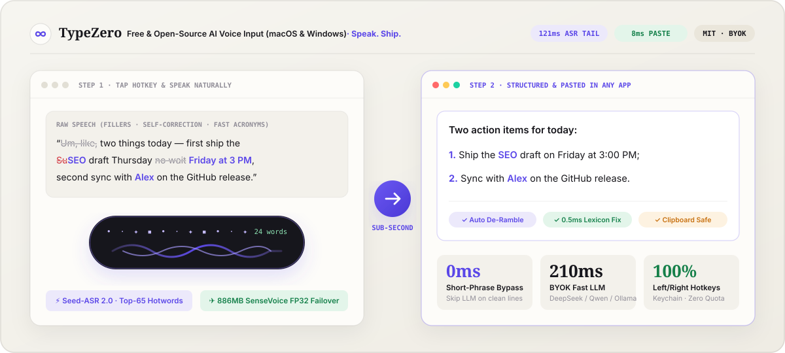

# TypeZero — Parlez, ne tapez plus

**Dictée vocale IA native macOS à latence ultra-faible et structuration de texte de niveau Typeless — conçu en pur Swift + C++.**

[](https://github.com/nasadunadu/TypeZero/releases/latest)
[](https://github.com/nasadunadu/TypeZero/releases/latest)
[](https://github.com/nasadunadu/TypeZero/releases/latest)
[](#architecture-double-moteur)
[](./SECURITY.md)
[](./LICENSE)

[English](./README.md) · [简体中文](./README.zh-CN.md) · [日本語](./README.ja.md) · [한국어](./README.ko.md) · **Français**

[**Télécharger l'installeur macOS (DMG v0.4.10)**](https://github.com/nasadunadu/TypeZero/releases/latest/download/TypeZero-v0.4.10-macOS-arm64.dmg) · [Journal d'architecture](./docs/STATUS_LOG.md)



---

## Installation en 10 secondes

### Téléchargement direct (Recommandé · Notarié par Apple)
1. Téléchargez [**`TypeZero-v0.4.10-macOS-arm64.dmg`**](https://github.com/nasadunadu/TypeZero/releases/latest/download/TypeZero-v0.4.10-macOS-arm64.dmg) et glissez **`TypeZero.app`** dans **`Applications`**.
2. Lancez **TypeZero** : l'assistant intégré en 3 étapes vous guide pour activer le micro et l'accessibilité, enregistrer vos clés API (uniquement dans le Trousseau macOS) et choisir votre raccourci global.

### Homebrew Cask
```bash
brew tap nasadunadu/typezero https://github.com/nasadunadu/TypeZero
brew install --cask typezero
```

---

## Pourquoi choisir TypeZero ?

La plupart des applications de dictée IA imposent un abonnement de 10 à 15 \$/mois avec des quotas de mots, ajoutent `1,5 à 3,0 s` de latence après avoir parlé et déforment régulièrement vos noms propres ou acronymes techniques.

**TypeZero** offre une réactivité instantanée et une structuration intelligente dans une application macOS native **100 % open source (licence MIT), sans abonnement et sans quota** :

- **Double moteur acoustique (`121 ms` Cloud + bascule hors ligne sans perte)** : diffuse en temps réel via WebSocket binaire natif vers **Volcengine Seed-ASR 2.0** (avec injection dynamique de vos 65 termes contextuels les plus pertinents) et bascule automatiquement, sans perdre une seule syllabe, vers un modèle local C++ **`sherpa-onnx` SenseVoice FP32 (886 Mo)** hors ligne ou en avion (téléchargement intégré en 1 clic).
- **Mode Capsule zéro scintillement + frappe en direct optionnelle** : par défaut, garde votre champ de saisie parfaitement propre pendant que des micro-symboles (`• · ✦`) et un compteur de caractères s'animent au-dessus d'une onde sinusoïdale 120 Hz, puis colle le texte finalisé en **`~8 ms`** tout en préservant votre presse-papiers. Un simple clic permet aussi d'activer la frappe caractère par caractère (`11–18 ms`/caractère avec auto-correction locale).
- **Contournement instantané `0 ms` pour phrases courtes propres (`<= 28` car.)** : les phrases courtes déjà ponctuées sans hésitations ni auto-corrections sont collées immédiatement sans attendre un second appel LLM.
- **Formatage sémantique complet (niveau Typeless)** : supprime les tics de langage et les reformulations en cours de phrase, structure automatiquement les listes numérotées (`1. 2. 3.`), les puces (`- `) et les paragraphes, et empêche la duplication de numéros (`2. 2.`) dans Cursor, Notion ou Feishu.
- **Raccourcis Gauche & Droite complets + enregistreur personnalisé** : distinction matérielle exacte pour **`Fn`**, **`Option ⌥`** gauche/droite, **`Command ⌘`** gauche/droite, **`Control ⌃`** gauche/droite, **`Shift ⇧`** gauche/droite, **`⌥ + Space`**, plus un **enregistreur de raccourcis personnalisés** via Carbon `RegisterEventHotKey` (zéro caractère parasite dans l'éditeur, et protection anti-faux déclenchement `140 ms` pour que `⌘+C` ou `⇧+A` ne déclenchent jamais la dictée).
- **Panneau unifié Modèles & Clés (cochez pour activer)** : les moteurs ASR et les LLM de formatage (**OpenAI GPT**, **Google Gemini**, **Anthropic Claude**, **DeepSeek 4 Flash**, **Volcengine Doubao-Seed**, **Alibaba Qwen-Flash**, **OpenAI personnalisé / Ollama & LM Studio en local**) regroupent leur case d'activation, leur clé API, leur identifiant de modèle et leur test de latence en direct dans une même carte.
- **Lexique personnel auto-apprenant (`< 0,5 ms`)** : rappel phonétique tolérant aux accents, correction d'acronymes respectant les frontières de mots, apprentissage automatique depuis vos corrections manuelles et apprentissage permanent par réécriture vocale de texte sélectionné.

---

## Comparatif des solutions de dictée sur macOS

| Capacité | Dictée macOS native | Freemium (`闪电说`) | Abonnement (`Typeless` / `Wispr Flow`) | **TypeZero (Open Source MIT)** |
| :--- | :--- | :--- | :--- | :--- |
| **Tarif & Quota** | Gratuit | Gratuit limité + Payant | 10–15 \$/mois (quota limité) | **100 % Gratuit · Illimité · Licence MIT** |
| **Moteur acoustique** | Dictée Apple | Local / Cloud | Envoi Cloud par lot | **Seed-ASR 2.0 (`121 ms`) + Bascule FP32 886 Mo hors ligne** |
| **Suppression des hésitations & structure** | Aucune | Oui | Oui | **Oui (OpenAI / Gemini / Claude / DeepSeek / Doubao / Qwen / Ollama BYOK)** |
| **Latence sur phrases courtes** | Rapide, sans mise en forme | `300–600 ms` | `700–1500 ms` | **Contournement `0 ms` (`<= 28` car.) · Collage `~8 ms`** |
| **Raccourcis (Gauche & Droite)** | Préréglage système | Gauche/Droite + Combos | Limité | **Tous les modificateurs G/D + `⌥Space` + Combos Carbon** |
| **Lexique personnel & apprentissage** | Aucun | Liste manuelle + auto | Cloud auto-apprenant | **Rappel phonétique local `< 0,5 ms` + Auto-apprentissage 3 voies** |
| **Confidentialité & Clés** | Apple | Éditeur / Local | Cloud éditeur | **BYOK · Trousseau macOS · Mode 100 % hors ligne disponible** |

---

## Architecture double moteur

```text
Entrée Micro (CoreAudio rééchantillonnage polyphase 48 kHz -> 16 kHz Int16 + AGC chuchotement 25 dB)
  ├── Principal : Volcengine Seed-ASR 2.0 WebSocket binaire (Top 65 hotwords dynamiques, fin ~121 ms)
  └── Secours :   C++ embarqué sherpa-onnx SenseVoice FP32 (886 Mo sans perte, bascule hors ligne 0 perte)
          │
          ▼
  Passe 1 (<0,5 ms) : Lexique personnel instantané + Acronymes + Contournement 0 ms (<=28 car.)
          │
          ▼ (si texte long / hésitations / reformulation / liste)
  Passe 2 (~210 ms TTFT) : LLM sélectionné (DeepSeek / Doubao-Seed / Qwen-Flash / Ollama) en SSE
          │
          ▼
  Injection atomique (Collage ~8 ms préservant le presse-papiers ou frappe en direct 11 ms)
```

---

## Compiler depuis les sources

Prérequis : Mac Apple Silicon (`arm64`), macOS 14.0+ et Xcode Command Line Tools (`swift` >= 5.10).

```bash
git clone https://github.com/nasadunadu/TypeZero.git
cd TypeZero

# 1. Télécharger la bibliothèque native C++ sherpa-onnx macOS arm64
./scripts/setup-vendor.sh

# 2. Exécuter les 40 tests de régression déterministes (0 avertissement)
./scripts/run-tests.sh

# 3. Compiler TypeZero.app
./scripts/build-app.sh
open ./build/TypeZero.app
```

---

## Licence

Distribué sous [licence MIT](./LICENSE).
