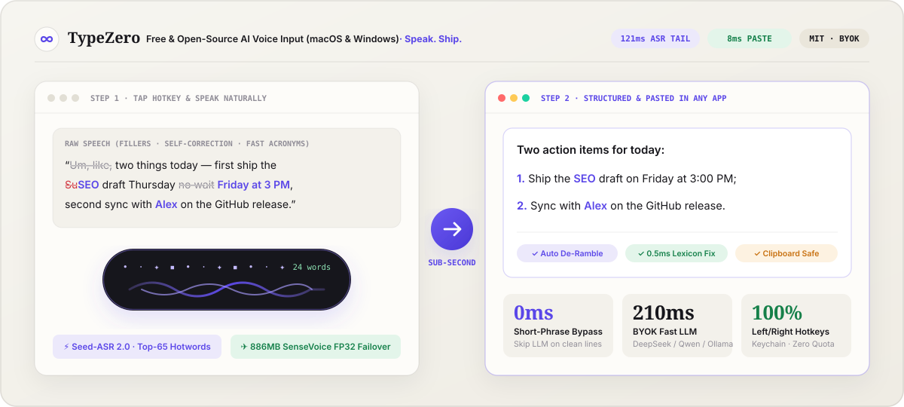

# TypeZero — 話して書く、打たない新体験

**純粋な Swift + C++ で構築された、超低遅延ネイティブ macOS AI 音声入力＆構造化ライティングアプリ**

[](https://github.com/nasadunadu/TypeZero/releases/latest)
[](https://github.com/nasadunadu/TypeZero/releases/latest)
[](https://github.com/nasadunadu/TypeZero/releases/latest)
[](#デュアルエンジン音声認識アーキテクチャ)
[](./SECURITY.md)
[](./LICENSE)

[English](./README.md) · [简体中文](./README.zh-CN.md) · **日本語** · [한국어](./README.ko.md) · [Français](./README.fr.md)

[**macOS インストーラーをダウンロード (DMG v0.4.10)**](https://github.com/nasadunadu/TypeZero/releases/latest/download/TypeZero-v0.4.10-macOS-arm64.dmg) · [アーキテクチャログ](./docs/STATUS_LOG.md)



---

## 10 秒でインストール

### 直接ダウンロード（おすすめ・Apple 公証済み）
1. [**`TypeZero-v0.4.10-macOS-arm64.dmg`**](https://github.com/nasadunadu/TypeZero/releases/latest/download/TypeZero-v0.4.10-macOS-arm64.dmg) をダウンロードし、**`TypeZero.app`** を **`Applications`** フォルダにドラッグします。
2. **TypeZero** を起動すると、3 ステップの初期セットアップガイドが表示され、マイク・アクセシビリティ権限、API キー（macOS キーチェーンにのみ暗号化保存）、グローバルショートカットを迷わず設定できます。

### Homebrew Cask
```bash
brew tap nasadunadu/typezero https://github.com/nasadunadu/TypeZero
brew install --cask typezero
```

---

## TypeZero が選ばれる理由

多くの AI 音声入力ツールは月額 \$10〜\$15 のサブスクリプションや文字数制限があり、録音終了後に `1.5〜3.0 秒` の待ち時間が発生したり、固有名詞・略語の誤変換に悩まされがちです。

**TypeZero** は、**完全オープンソース（MIT ライセンス）・サブスク不要・文字数無制限** のネイティブ macOS アプリとして設計されています：

- **デュアル音声認識エンジン（クラウド `121ms` ＋ オフライン `0` 欠落フェイルオーバー）**：通常時はネイティブ Binary WebSocket で **Volcengine Seed-ASR 2.0** にストリーミング接続（最大 65 語の文脈ホットワードを動的注入）。機内やオフライン時は内蔵 C++ **`sherpa-onnx` 886MB SenseVoice FP32** ローカルモデルへ 1 音節も落とさず自動切替します（アプリ内ワンクリックダウンロード対応）。
- **ゼロちらつきカプセルモード ＋ リアルタイム逐次入力切替**：デフォルトでは入力欄を汚さず、120Hz サイン波カプセル上にリズム記号（`• · ✦`）と文字数を表示し、発話終了後にクリップボード復元付きで約 **`8ms`** 一括ペーストします。1 文字ずつリアルタイムに入力欄へ出したい場合はワンクリックで切替可能（`11〜18ms`/字 ＋ 発話中ローカル自動修正）。
- **28 文字以下のクリーン短文を `0ms` バイパス**：フィラーや言い直し・箇条書きのない短い発話は、第 2 パスの LLM 整形をスキップして即座に入力欄へ反映します。
- **Typeless 級の自動構造化整形**：フィラー（「えーと」「あの」）や途中の言い直しを自動除去し、番号付きリスト（`1. 2. 3.`）・箇条書き（`- `）・段落分けを自動判定。Cursor / Notion / Feishu 等でのリスト番号重複（`2. 2.`）も自動で防止します。
- **左右フル対応ショートカット ＋ カスタムキー録画**：**`Fn`**、左右の **`Option ⌥`** / **`Command ⌘`** / **`Control ⌃`** / **`Shift ⇧`**、**`⌥ + Space`** をハードウェアキーコード＆左右デバイスフラグで厳密に区別。さらに Carbon `RegisterEventHotKey` による任意コンボ録画にも対応し、左側修飾キー長押し時の `140ms` 誤爆防止ガードで `⌘+C` や `⇧+A` を邪魔しません。
- **チェックで即有効・モデル＆キー一体型設定パネル**：音声エンジン・整形 LLM（**DeepSeek 4 Flash**、**Volcengine Doubao-Seed**、**Alibaba Qwen-Flash**、**カスタム OpenAI / ローカル Ollama & LM Studio**）ごとにチェックボックス・API キー・モデル ID・ライブ速度テストを同一カード内に集約。チェックしたモデルがそのまま即時に有効化されます。
- **自己学習パーソナル辞書（`<0.5ms` 高速リコール）**：発音の揺らぎに強い音韻インデックス、単語境界を保つ英略語補正、入力後の手動修正や選択テキスト音声リライトからの自動学習を搭載。

---

## 主要音声入力ツール比較

| 機能・特徴 | macOS 標準音声入力 | フリーミアム（闪电说 等） | サブスク型（Typeless / Wispr Flow） | **TypeZero（MIT オープンソース）** |
| :--- | :--- | :--- | :--- | :--- |
| **料金・利用制限** | 無料 | 無料枠＋有料プラン | 月額 \$10〜\$15（無料枠制限あり） | **完全無料・無制限・MIT ライセンス** |
| **音声認識エンジン** | Apple 標準 | ローカル / クラウド | クラウド一括送信 | **Seed-ASR 2.0 (`121ms`) ＋ 886MB FP32 オフライン熱待機** |
| **口癖除去・自動構造化** | なし | 対応 | 対応 | **対応（OpenAI / Gemini / Claude / DeepSeek / Doubao / Qwen / Ollama 自由切替）** |
| **短文の確定レイテンシ** | 高速（無整形） | `300〜600ms` | `700〜1500ms` | **28 文字以下 `0ms` バイパス・約 `8ms` 瞬時貼付** |
| **ショートカット対応** | システム固定 | 左右キー＋コンボ | 限定的 | **全左右修飾キー ＋ `⌥Space` ＋ 任意コンボ録画** |
| **個人辞書・自己学習** | なし | 手動辞書＋学習 | クラウド同期学習 | **`<0.5ms` ローカル音韻辞書 ＋ 3 経路自動学習** |
| **プライバシー・キー保管** | Apple | ベンダー / ローカル | ベンダークラウド | **BYOK・macOS キーチェーン・完全オフライン対応** |

---

## デュアルエンジン音声認識アーキテクチャ

```text
マイク入力 (CoreAudio 多相アンチエイリアス 48kHz -> 16kHz Int16 + 25dB ささやき声 AGC)
  ├── メイン: Volcengine Seed-ASR 2.0 Binary WebSocket (Top-65 動的ホットワード・末尾確定 ~121ms)
  └── 予備:   組込 C++ sherpa-onnx SenseVoice FP32 (886MB 非量子化・オフライン 0 欠落自動切替)
          │
          ▼
  Pass 1 (<0.5ms): ローカル個人辞書即時置換 ＋ 英略語境界補正 ＋ 28 文字以下クリーン短文 0ms バイパス判定
          │
          ▼ (長文・フィラー・言い直し・リスト構造がある場合)
  Pass 2 (~210ms TTFT): チェック中の LLM (DeepSeek / Doubao-Seed / Qwen-Flash / Ollama) SSE 構造化整形
          │
          ▼
  高速ペースト (デフォルト ~8ms クリップボード復元一括貼付 / 任意で 11ms 逐次入力モード)
```

---

## ソースからビルド

必要環境：Apple Silicon Mac (`arm64`)、macOS 14.0 以降、Xcode Command Line Tools（Swift 5.10+ / Swift 6）。

```bash
git clone https://github.com/nasadunadu/TypeZero.git
cd TypeZero

# 1. sherpa-onnx macOS arm64 C++ ランタイムを取得
./scripts/setup-vendor.sh

# 2. 40 項目の回帰テストを実行（警告 0）
./scripts/run-tests.sh

# 3. TypeZero.app をビルド
./scripts/build-app.sh
open ./build/TypeZero.app
```

---

## ライセンス

[MIT License](./LICENSE) の下で公開されています。
