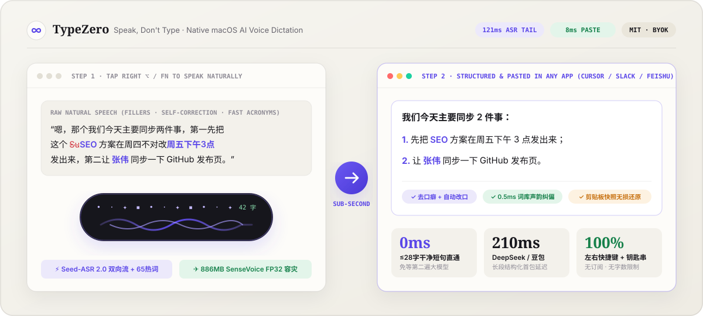

# TypeZero — 타이핑 대신 말로 바로 완성

**순수 Swift + C++로 제작된 초저지연 네이티브 macOS AI 음성 입력 및 구조화 텍스트 정리 앱**

[](https://github.com/nasadunadu/TypeZero/releases/latest)
[](https://github.com/nasadunadu/TypeZero/releases/latest)
[](https://github.com/nasadunadu/TypeZero/releases/latest)
[](#듀얼-엔진-음성-인식-아키텍처)
[](./SECURITY.md)
[](./LICENSE)

[English](./README.md) · [简体中文](./README.zh-CN.md) · [日本語](./README.ja.md) · **한국어** · [Français](./README.fr.md)

[**macOS 설치 파일 다운로드 (DMG v0.4.1)**](https://github.com/nasadunadu/TypeZero/releases/latest/download/TypeZero-v0.4.1-macOS-arm64.dmg) · [아키텍처 로그](./docs/STATUS_LOG.md)



---

## 10초 만에 설치하기

### 직접 다운로드 (권장 · Apple 공증 완료)
1. [**`TypeZero-v0.4.1-macOS-arm64.dmg`**](https://github.com/nasadunadu/TypeZero/releases/latest/download/TypeZero-v0.4.1-macOS-arm64.dmg)를 다운로드한 뒤 **`TypeZero.app`**을 **`Applications`** 폴더로 드래그하세요.
2. **TypeZero**를 실행하면 3단계 온보딩 마법사가 마이크/손쉬운 사용 권한, API 키(macOS 시스템 키체인에만 암호화 저장), 전역 단축키 설정을 안내합니다.

### Homebrew Cask
```bash
brew tap nasadunadu/typezero https://github.com/nasadunadu/TypeZero
brew install --cask typezero
```

---

## 왜 TypeZero인가요?

대부분의 AI 음성 입력 앱은 월 \$10–\$15의 유료 구독과 단어 수 제한이 있거나, 발화 종료 후 `1.5–3.0초`의 대기 지연이 발생하며, 개인 고유명사나 기술 약어를 자주 잘못 인식합니다.

**TypeZero**는 **100% 오픈소스(MIT 라이선스) · 무구독 · 무제한** 네이티브 macOS 앱으로 다음 경험을 제공합니다:

- **듀얼 음성 인식 엔진 (클라우드 `121ms` + 오프라인 누락 0% 페일오버)**: 평소에는 네이티브 Binary WebSocket으로 **Volcengine Seed-ASR 2.0**에 실시간 스트리밍(문맥 기반 상위 65개 핫워드 동적 주입)하며, 오프라인이나 기내에서는 내장 C++ **`sherpa-onnx` 886MB SenseVoice FP32** 로컬 모델로 단 한 음절의 손실 없이 자동 전환됩니다(앱 내 원클릭 다운로드 지원).
- **깜빡임 없는 캡슐 모드 + 선택형 실시간 타이핑**: 기본 모드에서는 입력창을 깨끗하게 유지한 채 120Hz 사인파 캡슐 위에 리듬 기호(`• · ✦`)와 글자 수를 표시하고, 발화가 끝나면 기존 클립보드를 보존하면서 약 **`8ms`** 만에 완성 문장을 붙여넣습니다. 실시간 한 글자씩 입력 모드(`11–18ms`/글자 + 발화 중 실시간 꼬리 자동 수정)도 원클릭으로 전환할 수 있습니다.
- **28자 이하 깔끔한 단문 `0ms` 패스스루**: 군더더기나 말 수정, 목록 구조가 없는 짧은 문장은 2차 LLM 호출 없이 즉시 입력창에 반영됩니다.
- **Typeless급 지능형 구조화 정리**: 말버릇과 도중 정정 발화를 깔끔히 제거하고, 번호 목록(`1. 2. 3.`) · 글머리 기호(`- `) · 자연스러운 문단 분리를 자동 적용합니다. Cursor / Notion / Feishu 등에서 발생하는 `2. 2.` 중복 목록 번호도 자동 방지합니다.
- **좌/우 모든 보조키 완벽 지원 + 커스텀 단축키 녹화**: **`Fn`**, 좌/우 **`Option ⌥`**, 좌/우 **`Command ⌘`**, 좌/우 **`Control ⌃`**, 좌/우 **`Shift ⇧`**, **`⌥ + Space`**를 하드웨어 키코드와 좌우 디바이스 마스크로 엄격히 구분합니다. 또한 Carbon `RegisterEventHotKey` 기반 사용자 지정 조합키 녹화와 왼쪽 보조키 `140ms` 오작동 방지 가드(`⌘+C` / `⇧+A` 간섭 제로)를 제공합니다.
- **체크 즉시 적용 · 모델/키 통합 설정 패널**: 음성 인식 엔진과 정리용 LLM(**DeepSeek 4 Flash**, **Volcengine Doubao-Seed**, **Alibaba Qwen-Flash**, **커스텀 OpenAI / 로컬 Ollama & LM Studio**) 각각의 카드 안에 체크박스, API 키, 모델 ID, 실시간 속도 측정을 하나로 통합했습니다. 체크한 모델이 즉시 활성화됩니다.
- **자가 학습 개인 사전 (`<0.5ms` 초고속 호출)**: 발음 유사도 인덱스, 단어 경계 기반 영문 약어 보정, 입력 후 수동 수정 자동 학습 및 선택 텍스트 음성 수정 영구 학습을 지원합니다.

---

## 주요 음성 입력 도구 비교

| 핵심 기능 | macOS 기본 받아쓰기 | 부분 유료 (闪电说 등) | 구독형 (Typeless / Wispr Flow) | **TypeZero (MIT 오픈소스)** |
| :--- | :--- | :--- | :--- | :--- |
| **가격 및 사용량** | 무료 | 무료 티어 + 유료 플랜 | 월 \$10–\$15 (무료 단어 제한) | **100% 무료 · 무제한 · MIT 라이선스** |
| **음성 인식 엔진** | Apple 기본 | 로컬 / 클라우드 | 클라우드 일괄 업로드 | **Seed-ASR 2.0 (`121ms`) + 886MB FP32 오프라인 페일오버** |
| **말버릇 제거 및 구조화** | 없음 | 지원 | 지원 | **지원 (DeepSeek / Doubao / Qwen / Ollama 자유 선택)** |
| **단문 입력 지연 시간** | 빠름 (무정리) | `300–600ms` | `700–1500ms` | **28자 이하 `0ms` 패스스루 · 약 `8ms` 붙여넣기** |
| **단축키 지원 범위** | 시스템 기본값 | 좌/우 키 + 조합 | 제한적 프리셋 | **모든 좌/우 보조키 + `⌥Space` + 임의 조합키 녹화** |
| **개인 사전 및 자가 학습** | 없음 | 수동 사전 + 학습 | 클라우드 동기화 학습 | **`<0.5ms` 로컬 음운 사전 + 3중 자동 학습** |
| **개인정보 및 키 보관** | Apple | 벤더 / 로컬 | 벤더 클라우드 | **BYOK · macOS 키체인 · 100% 오프라인 모드 지원** |

---

## 듀얼 엔진 음성 인식 아키텍처

```text
마이크 입력 (CoreAudio 다상 리샘플링 48kHz -> 16kHz Int16 + 25dB 속삭임 자동 증폭 AGC)
  ├── 메인: Volcengine Seed-ASR 2.0 Binary WebSocket (상위 65개 동적 핫워드 · 종료 확정 ~121ms)
  └── 백업: 내장 C++ sherpa-onnx SenseVoice FP32 (886MB 무손실 · 오프라인 0음절 누락 자동 전환)
          │
          ▼
  Pass 1 (<0.5ms): 로컬 개인 사전 즉시 교정 + 영문 약어 경계 보정 + 28자 이하 0ms 패스스루 판별
          │
          ▼ (장문 / 말버릇 / 수정 / 목록 구조 포함 시)
  Pass 2 (~210ms TTFT): 선택된 LLM (DeepSeek / Doubao-Seed / Qwen-Flash / Ollama) SSE 구조화 정리
          │
          ▼
  초고속 입력 (기본 ~8ms 클립보드 보존 일괄 붙여넣기 / 선택형 11ms 실시간 타이핑)
```

---

## 소스에서 빌드하기

요구 사항: Apple Silicon Mac (`arm64`), macOS 14.0+, Xcode Command Line Tools (`swift` 5.10+ / Swift 6).

```bash
git clone https://github.com/nasadunadu/TypeZero.git
cd TypeZero

# 1. sherpa-onnx macOS arm64 C++ 런타임 다운로드
./scripts/setup-vendor.sh

# 2. 34개 핵심 회귀 테스트 실행 (컴파일 경고 0)
./scripts/run-tests.sh

# 3. TypeZero.app 빌드
./scripts/build-app.sh
open ./build/TypeZero.app
```

---

## 라이선스

[MIT License](./LICENSE)에 따라 배포됩니다.
