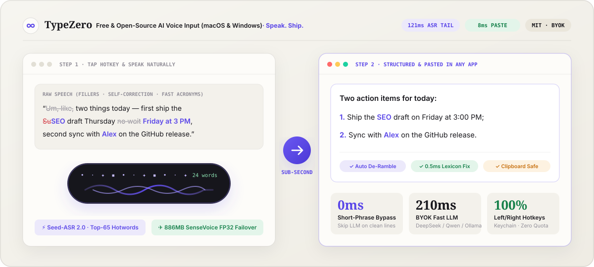

# TypeZero — Speak, Don't Type

**Ultra-low-latency native macOS AI voice dictation & Typeless-grade text structuring — built in pure Swift + C++.**

[](https://github.com/nasadunadu/TypeZero/releases/latest)
[](https://github.com/nasadunadu/TypeZero/releases/latest)
[](https://github.com/nasadunadu/TypeZero/releases/latest)
[](#dual-engine-architecture)
[](./SECURITY.md)
[](./LICENSE)

**English** · [简体中文](./README.zh-CN.md) · [日本語](./README.ja.md) · [한국어](./README.ko.md) · [Français](./README.fr.md)

[**Download macOS DMG (v0.4.8)**](https://github.com/nasadunadu/TypeZero/releases/latest/download/TypeZero-v0.4.8-macOS-arm64.dmg) · [Architecture Log](./docs/STATUS_LOG.md)



---

## Install in 10 Seconds

### Direct Download (Recommended)
1. Download [**`TypeZero-v0.4.8-macOS-arm64.dmg`**](https://github.com/nasadunadu/TypeZero/releases/latest/download/TypeZero-v0.4.8-macOS-arm64.dmg) and drag **`TypeZero.app`** into **`Applications`**.
2. Open **TypeZero** — the built-in 3-step onboarding wizard guides you through Microphone & Accessibility permissions, API keys (stored solely in your macOS Keychain), and your preferred global hotkey.

### Homebrew Cask
```bash
brew tap nasadunadu/typezero https://github.com/nasadunadu/TypeZero
brew install --cask typezero
```

---

## Why TypeZero?

Most voice dictation apps lock you into \$10–\$15/month word-capped subscriptions, introduce `1.5s–3.0s` upload lag, or lose your personal names and technical acronyms.

**TypeZero** brings Typeless-level intelligence and Doubao-grade responsiveness to an **open-source, MIT-licensed, zero-subscription** native macOS app:

- **Tri-Engine Acoustic Recognition (Volcengine Seed-ASR 2.0 · OpenAI / Groq Cloud Speech · `0`-Drop Offline Failover)**: Choose between native binary WebSocket streaming (**Volcengine Seed-ASR 2.0**, `121ms` tail), **OpenAI (`gpt-4o-mini-transcribe` / `gpt-4o-transcribe`) & Groq (`whisper-large-v3-turbo`)** cloud speech APIs (auto-reusing your OpenAI key with personal lexicon prompt injection), or pure offline C++ **`sherpa-onnx` 886MB SenseVoice FP32** — with automatic zero-dropped-syllable local failover when offline.
- **Zero-Flicker Capsule Mode + Optional Live Typewriter**: By default, keeps your text field 100% clean while displaying live rhythmic micro-symbols (`• · ✦`) and character count above a 120Hz sine-wave capsule, then lands the final structured text atomically in **`~8ms`** via clipboard-preserving paste. Prefer character-by-character live streaming? Flip one toggle to enable `11ms–18ms` inline typing with live `<=6`-char self-correction.
- **Smart `<=28`-Char Clean Cloud Bypass (`0ms` Pass-2)**: Clean punctuated single sentences (`<= 28` chars) without fillers, self-corrections, or list cues paste immediately after speech ends without waiting for an LLM round-trip.
- **Typeless 5-Pillar Semantic Formatting**: Removes fillers (`嗯/啊/那个`) and mid-sentence self-corrections, auto-routes numbered (`1. 2. 3.`) vs bulleted (`- `) lists, splits long monologues into crisp paragraphs, applies CJK-Latin Pangu spacing & Arabic numeral ITN, and prevents Markdown auto-list `2. 2.` duplication in Cursor / Notion / Feishu.
- **Full Left & Right Shortcuts + Custom Combo Recorder**: Native hardware keyCode & IOKit left/right isolation for **`Fn`**, **Left/Right `Option ⌥`**, **Left/Right `Command ⌘`**, **Left/Right `Control ⌃`**, **Left/Right `Shift ⇧`**, **`⌥ + Space`**, plus a 1-click **Custom Hotkey Recorder** backed by Carbon `RegisterEventHotKey` (zero leaked characters into editors, plus 140ms hold-to-talk combo protection so `⌘+C` / `⇧+A` never false-trigger).
- **Unified Check-to-Activate Engine & Key Panel**: Speech models and formatting LLMs (**OpenAI GPT**, **Google Gemini**, **Anthropic Claude**, **DeepSeek 4 Flash**, **Volcengine Doubao-Seed**, **Alibaba Qwen-Flash**, or **Custom OpenAI / Local Ollama & LM Studio**) keep their API keys, model IDs, and live latency probes right inside each checkable card — check a model and it immediately takes effect.
- **Self-Evolving Personal Lexicon (`<0.5ms` Fuzzy Phonetic Recall)**: Tone-free accent-tolerant phonetic skeleton (`zh/z`, `sh/s`, `ing/in`, `n/l`), word-boundary acronym glide fixes (`Su` -> `SEO` without touching `Summary`/`Supabase`), multi-paragraph manual-edit auto-learning via Apple `NLTokenizer`, and selected-text voice rewrite teach-in.

---

## Competitor Comparison Matrix

| Capability | macOS Built-in Dictation | Freemium (`闪电说`) | Subscription (`Typeless` / `Wispr Flow`) | **TypeZero (MIT Open Source)** |
| :--- | :--- | :--- | :--- | :--- |
| **Pricing & Quota** | Free | Free tier + Paid plans | \$10–\$15/mo (word cap on free) | **100% Free · Unlimited · MIT License** |
| **Acoustic Engine** | Apple Dictation | Local / Cloud | Cloud batch upload | **Seed-ASR 2.0 / OpenAI & Groq ASR + 886MB FP32 Failover** |
| **Formatting & De-Rambling** | None (literal typos) | Yes | Yes (5-pillar structuring) | **Yes (OpenAI / Gemini / Claude / DeepSeek / Doubao / Qwen / Ollama BYOK)** |
| **Short-Sentence Latency** | Fast, no formatting | `300–600ms` | `700–1500ms` | **`0ms` Pass-2 Bypass (`<=28` chars) · `~8ms` Paste** |
| **Shortcuts (Left & Right)** | System preset only | Left/Right + Combos | Limited presets | **All Left/Right Modifiers + Custom Carbon Combos** |
| **Personal Lexicon & Learning** | None | Manual list + auto-learn | Cloud-synced auto-learn | **`<0.5ms` Local Fuzzy Phonetic + 3-Way Auto-Learn** |
| **Privacy & Credential Storage** | Apple | Vendor / Local | Vendor Cloud | **BYOK · macOS Keychain (`SecItem`) · Optional 100% Offline** |

---

## Dual-Engine Architecture

```text
Mic Audio (CoreAudio AVAudioConverter Polyphase 48kHz -> 16kHz Int16 + 25dB Whisper AGC)
  ├── Primary: Volcengine Seed-ASR 2.0 Binary WebSocket (Direct, Top-65 Context Hotwords, ~121ms tail)
  └── Standby: Embedded C++ sherpa-onnx SenseVoice FP32 (886MB lossless, 0-drop auto failover)
          │
          ▼
  Pass 1 (<0.5ms): Instant Personal Lexicon + Word-Boundary Acronym Glide + <=28-Char Clean Bypass Check
          │
          ▼ (if complex / rambling / list / homophone candidate)
  Pass 2 (~210ms TTFT): Checked LLM (DeepSeek 4 Flash / Doubao-Seed / Qwen-Flash / Custom / Ollama) SSE
          │
          ▼
  Atomic Cursor Injection (~8ms Clipboard-Preserving Paste or Optional 11ms Live Inline Typewriter)
          │
          ▼
  Passive Self-Learning Loop (Manual Edit Diff via NLTokenizer + Selected-Text Voice Teach-In)
```

---

## Build from Source

Requires macOS 14.0+ on Apple Silicon (`arm64`) and Xcode Command Line Tools (`swift` >= 5.10).

```bash
git clone https://github.com/nasadunadu/TypeZero.git
cd TypeZero

# 1. Fetch sherpa-onnx macOS arm64 shared C runtime
./scripts/setup-vendor.sh

# 2. Run 40 deterministic core regression assertions (0 compiler warnings)
./scripts/run-tests.sh

# 3. Build TypeZero.app (auto-signs with Developer ID if installed, else ad-hoc)
./scripts/build-app.sh
open ./build/TypeZero.app

# 4. (Optional) Build distributable DMG installer
./scripts/package-dmg.sh
```

---

## License

Released under the [MIT License](./LICENSE).
