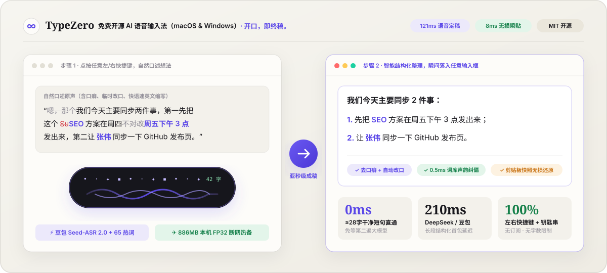

# TypeZero — 说话，不要打字

**纯原生 Swift + C++ 打造的 macOS 超低延迟 AI 语音成稿与结构化排版工具**

[](https://github.com/nasadunadu/TypeZero/releases/latest)
[](https://github.com/nasadunadu/TypeZero/releases/latest)
[](https://github.com/nasadunadu/TypeZero/releases/latest)
[](#双擎声学与极速管线架构)
[](./SECURITY.md)
[](./LICENSE)

[English](./README.md) · **简体中文** · [日本語](./README.ja.md) · [한국어](./README.ko.md) · [Français](./README.fr.md)

[**直接下载 macOS 安装包 (DMG v0.4.5)**](https://github.com/nasadunadu/TypeZero/releases/latest/download/TypeZero-v0.4.5-macOS-arm64.dmg) · [架构演进日志](./docs/STATUS_LOG.md)



---

## 10 秒极速安装

### 方式一：直接下载 DMG（推荐）
1. 下载 [**`TypeZero-v0.4.5-macOS-arm64.dmg`**](https://github.com/nasadunadu/TypeZero/releases/latest/download/TypeZero-v0.4.5-macOS-arm64.dmg)，将 **`TypeZero.app`** 拖入右侧 **`Applications`**。
2. 打开 **TypeZero**，按内置 **3 步新手引导** 授予麦克风与辅助功能权限、填入个人 API Key（仅加密存于本机 macOS 钥匙串）并选定快捷键即可全局使用。

### 方式二：Homebrew Cask 一键安装
```bash
brew tap nasadunadu/typezero https://github.com/nasadunadu/TypeZero
brew install --cask typezero
```

---

## 核心特性

- **三擎声学识别底座（豆包 Seed-ASR 2.0 · OpenAI / Groq 云端语音 · 本机 886MB FP32 离线热备）**：自由勾选火山 **豆包流式语音大模型 2.0 (`Seed-ASR 2.0`)**（`121ms` 国内直连）、**OpenAI (`gpt-4o-mini-transcribe` / `gpt-4o-transcribe`) & Groq (`whisper-large-v3-turbo`)** 云端语音（自动复用 OpenAI Key 并注入个人词库提示），或纯本地 C++ **`sherpa-onnx` 886MB SenseVoice FP32**；任意云端断网或超时均可 0 丢字无缝切回本机满血模型。
- **默认「胶囊跳符 · 松手 8ms 瞬贴」+ 可选逐字跳出**：默认说话期间输入框保持 100% 干净，120Hz 悬浮音波上方实时跳动微符读字数，松手瞬间经剪贴板快照无损整段贴入；也支持一键切换为「前端输入框逐字跳出」（`11ms–18ms` 单字流式 + 说话中 `<=6` 字局部自纠错）。
- **≤28 字干净短句 `0ms` 免检直通**：豆包已精准标点且无口癖、无改口、无分点触发词的短句，松手后直接绕过第二遍大模型，零等待瞬贴上屏。
- **Typeless 级五柱智能排版**：自动删净口癖（嗯/啊/那个）与中途改口、智能路由有序 `1. 2. 3.` 与无序 `- ` 列表、长段按意群自动分段、中英文盘古留白与现代阿拉伯数字 ITN、自动修复 Cursor / Notion / 飞书的 `2. 2.` 双倍列表头。
- **全套左/右侧快捷键 + 自定义组合键录制**：完整覆盖 **`Fn`**、**左/右 `Option ⌥`**、**左/右 `Command ⌘`**、**左/右 `Control ⌃`**、**左/右 `Shift ⇧`**、**`⌥ + Space`** 及 **一键录制任意自定义组合键**（Carbon `RegisterEventHotKey` 原生拦截绝不向输入框漏字符；左侧修饰键在按住模式下内置 `140ms` 防误触保护，`⌘+C` / `⇧+A` 零干扰）。
- **模型与密钥一体化设定面板（勾选即生效）**：语音识别引擎与排版大模型（**OpenAI GPT**、**Google Gemini**、**Anthropic Claude**、**DeepSeek 4 Flash**、**火山方舟 Doubao-Seed**、**阿里百炼 Qwen-Flash**、**自定义 OpenAI / 本地 Ollama & LM Studio 免密接口**）均采用“勾选哪个生效哪个”的一体化卡片，密钥、模型 ID 与 ⚡ 实时测速全部内聚同框。
- **0.5ms 模糊声韵专属词库 + 三路自学习**：兼容平翘舌/前后鼻音/n-l 声韵骨架（`zh/z`、`ing/in`、`n/l`）、词边界英文缩写滑音纠偏、多段落手动改字无感自学习（Apple `NLTokenizer` 词边界对齐）与选中文字语音改写永久入库。

---

## 主流语音输入方案客观对比

| 核心维度 | macOS 系统听写 | 免费增值工具（如闪电说） | 海外订阅制（Typeless / Wispr Flow） | **TypeZero（MIT 开源）** |
| :--- | :--- | :--- | :--- | :--- |
| **价格与字数配额** | 免费 | 基础免费 + 会员增值 | \$10–\$15/月（免费版限字数） | **100% 开源免费 · 无字数上限 · MIT** |
| **声学识别引擎** | 苹果内置听写 | 本地 / 云端 | 纯云端整段上传 | **豆包 Seed-ASR 2.0 / OpenAI & Groq 语音 + 886MB FP32 热备** |
| **智能去口癖与分段排版** | 无（原样错别字） | 支持 | 支持（强结构化） | **支持（OpenAI / Gemini / Claude / DeepSeek / 豆包 / Qwen / Ollama 自由切换）** |
| **短句上屏延迟** | 快但无排版 | `300–600ms` | `700–1500ms` | **≤28字干净句 `0ms` 直通 · `~8ms` 瞬贴** |
| **快捷键覆盖** | 仅系统默认键 | 左右键 + 组合键 | 少量预设键 | **全套左右修饰键 + ⌥Space + 任意组合键录制** |
| **个人词库与自学习** | 无 | 手动词典 + 自学习 | 云端自学习 | **`<0.5ms` 本机模糊声韵词库 + 3 路无感自学习** |
| **隐私与密钥隔离** | 苹果系统 | 客户端 / 云端 | 服务商云端托管 | **BYOK · 独立存入 macOS 钥匙串 · 支持 100% 离线** |

---

## 双擎声学与极速管线架构

```text
麦克风采集 (CoreAudio 多相抗混叠 48kHz -> 16kHz Int16 + 25dB 气声耳语增益)
  ├── 主力云端：火山 Seed-ASR 2.0 二进制 WebSocket（国内直连 + Top 65 动态热词，收尾 ~121ms）
  └── 离线热备：内嵌 C++ sherpa-onnx SenseVoice FP32（886MB 无损浮点，断网 0 丢字无缝接管）
          │
          ▼
  第一道 (<0.5ms)：本地专属词库瞬修 + 英文词边界滑音纠偏 + ≤28 字干净短句 0ms 直通判定
          │
          ▼（长句 / 含口癖 / 改口 / 列表 / 同音候选）
  第二道 (~210ms TTFT)：当前勾选的大模型 SSE 流式结构化整理（关闭 CoT 思考 + 静态前缀缓存）
          │
          ▼
  极速上屏（默认 8ms 剪贴板快照无损瞬贴 / 可选 11ms 前端逐字流式生长）
          │
          ▼
  三路无感自学习（多段手动改字 NLTokenizer 对齐 + 选中语音改写永久入库 + 高频命中加权）
```

---

## 从源码构建

环境要求：Apple Silicon Mac (`arm64`)、macOS 14.0+、Xcode Command Line Tools（Swift 5.10+ / Swift 6）。

```bash
git clone https://github.com/nasadunadu/TypeZero.git
cd TypeZero

# 1. 拉取 sherpa-onnx macOS arm64 原生 C++ 动态库
./scripts/setup-vendor.sh

# 2. 编译并执行 33 项核心确定性回归测试（0 警告）
./scripts/run-tests.sh

# 3. 打包 TypeZero.app（自动使用本机开发者证书签名或 ad-hoc 签名）
./scripts/build-app.sh
open ./build/TypeZero.app

# 4. （可选）生成可分发 DMG 安装包
./scripts/package-dmg.sh
```

---

## 开源协议

本项目基于 [MIT License](./LICENSE) 开源。
